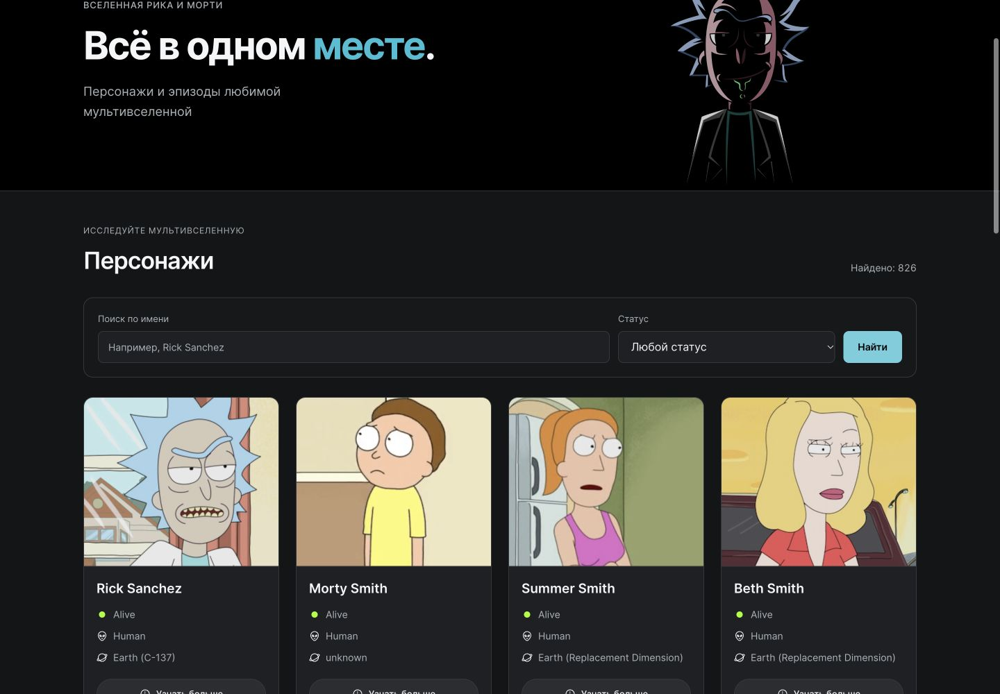
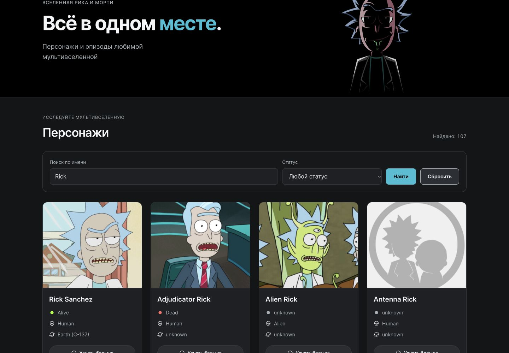
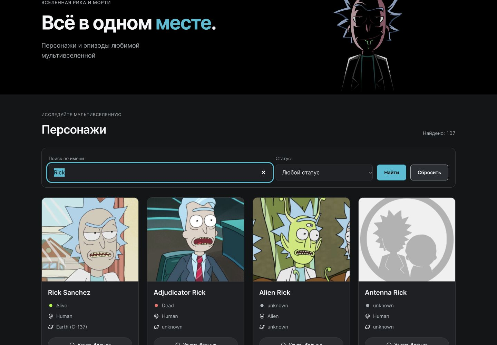

# BUG-001 — После поиска по Enter поле теряет клавиатурный фокус

| Поле                   | Значение                                                   |
| ---------------------- | ---------------------------------------------------------- |
| Статус                 | Open                                                       |
| Триаж                  | Needs triage — ожидаемое UX-поведение требует согласования |
| Severity               | Minor                                                      |
| Предлагаемый приоритет | P2; предложение QA, приоритет команды не назначен          |
| Дата обнаружения       | 2026-11-16                                                 |
| Связанный тест         | [TC-12](../test-cases.md#tc-12)                            |
| Воспроизводимость      | 2/2: запросы `Rick` и `Morty`                              |

## Окружение

- Публичное React-приложение: [Rick and Morty React](https://az212at.github.io/rick-and-morty-react/).
- ОС: macOS 27.0.1.
- Браузер: встроенный браузер. Версия браузера и движка не раскрыта инструментом; проверка не проводилась в Google Chrome.
- Размер viewport: 1440 × 1000 CSS px.
- Исходный код для анализа: commit `b70fef2810896b9764e5175dd239ae6b145df485`.
- Наблюдавшийся JS-ресурс публичной страницы: `/rick-and-morty-react/assets/index-PFm8c2b1.js`. Точное соответствие публичного bundle указанному commit отдельно не устанавливалось.
- Метод: взаимодействие с UI и чтение состояния DOM через инструмент встроенного браузера; это не запуск standalone Playwright и не Chrome DevTools.

## Предусловия

Открыть [каталог персонажей без фильтров](https://az212at.github.io/rick-and-morty-react/#/characters), дождаться загрузки карточек. Диалог персонажа закрыт.

## Шаги воспроизведения

1. Установить фокус в поле «Поиск по имени».
2. Ввести `Rick`.
3. Убедиться, что перед отправкой фокус находится в поле `input#character-name`.
4. Нажать Enter, не перемещая фокус мышью.
5. Дождаться результатов по адресу `#/characters?name=Rick`.
6. Проверить текущий фокус, затем нажать Tab один раз.
7. Для повтора заменить запрос на `Morty`, отправить Enter и снова дождаться результатов.

## Ожидаемый результат

После поиска сохраняется понятная клавиатурная позиция: фокус остаётся в поле поиска либо намеренно переносится на доступный заголовок/начало результатов. Если фокус остаётся в поле, следующий Tab переводит его на «Статус».

Это предложенный QA критерий удобства клавиатурной навигации. Согласованный продуктовый критерий пока отсутствует; отчёт не утверждает нарушение конкретного пункта WCAG.

## Фактический результат

Результаты успешно загружаются, но после Enter `document.activeElement` — `BODY`, идентификатор активного элемента пустой. Следующий Tab снова фокусирует `input#character-name`, а не следующий элемент формы. При повторном поиске `Morty` фокус также оказывается на `BODY`.

Пользователь теряет позицию в последовательности формы и должен повторно пройти поле поиска, чтобы продолжить настройку фильтров. Сам поиск работает.

## Доказательства

Состояния DOM записаны в [browser-observations.json](../evidence/browser-observations.json):

- `TC-12-before-enter`: перед Enter `tag: "INPUT"`, `value: "Rick"`.
- `TC-12-after-enter`: `activeTag: "BODY"`, `activeId: ""`, `count: 20`, URL `#/characters?name=Rick`.
- `TC-12-after-tab`: `activeTag: "INPUT"`, `activeId: "character-name"`.
- `TC-12-repeat`: `activeTag: "BODY"`, URL `#/characters?name=Morty`.

Скриншоты показывают этапы сценария; точное значение активного элемента подтверждается DOM-записями:

## Гипотеза причины по исходному коду

В [CharactersPage.tsx:56](https://github.com/Az212At/rick-and-morty-react/blob/b70fef2810896b9764e5175dd239ae6b145df485/src/pages/characters/ui/CharactersPage.tsx#L56) ключ формы зависит от `searchParams.toString()`. Отправка поиска меняет параметры URL, поэтому React может заменить форму вместе с активным полем. Явного переноса фокуса после этой замены в компоненте не видно.

Это гипотеза по локальному коду, согласующаяся с наблюдением. Трассировка React и подтверждение причины в опубликованном bundle не проводились.

## Регрессионные проверки после исправления

- Отправить `Rick` и затем `Morty` через Enter; проверить целевую позицию фокуса после обоих ответов.
- Продолжить Tab/Shift+Tab по форме и убедиться, что порядок остаётся логичным.
- Проверить отправку кнопкой «Найти», сочетание имени со статусом и сброс фильтров.
- Проверить восстановление полей при Back/Forward без возвращения прежней ошибки сброса черновика.
- Отдельно проверить аналогичный поиск эпизодов; переносимость дефекта на эту страницу пока не подтверждена.
