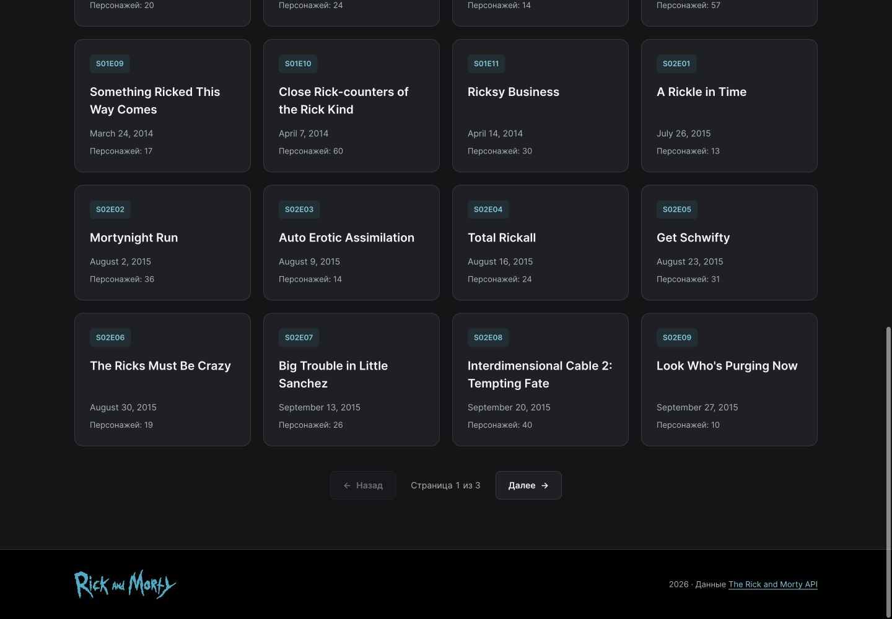
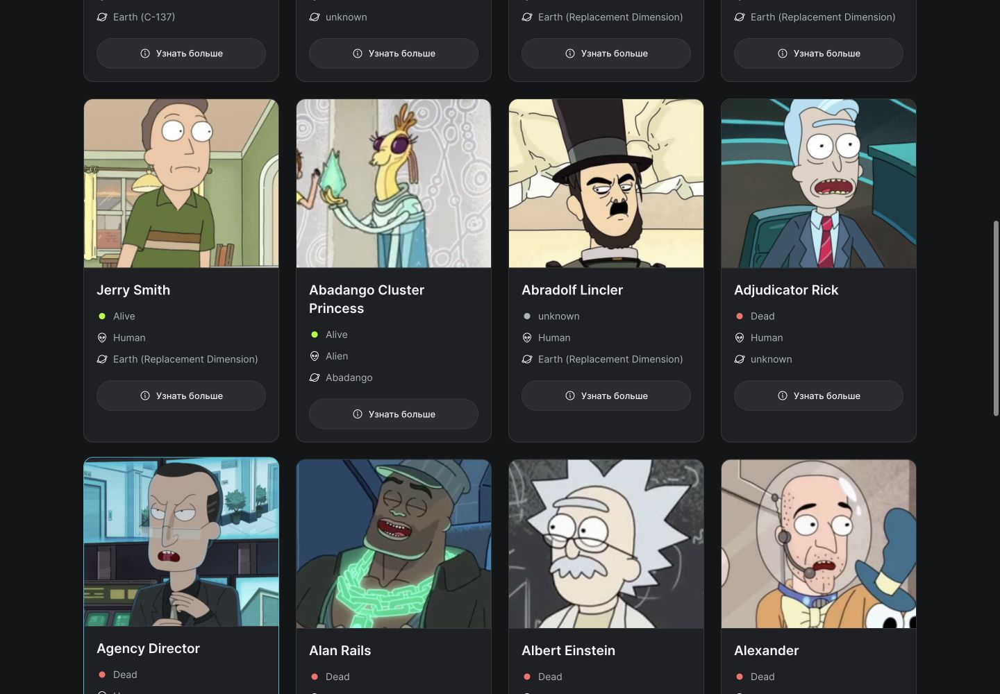

# BUG-002 — Переход из footer к персонажам сохраняет прокрутку старой страницы

| Поле                   | Значение                                                   |
| ---------------------- | ---------------------------------------------------------- |
| Статус                 | Open                                                       |
| Триаж                  | Needs triage — ожидаемое UX-поведение требует согласования |
| Severity               | Minor                                                      |
| Предлагаемый приоритет | P2; предложение QA, приоритет команды не назначен          |
| Дата обнаружения       | 2026-11-16                                                 |
| Связанный тест         | [TC-13](../test-cases.md#tc-13)                            |
| Воспроизводимость      | 2/2                                                        |

## Окружение

- Публичное React-приложение: [Rick and Morty React](https://az212at.github.io/rick-and-morty-react/).
- ОС: macOS 27.0.1.
- Браузер: встроенный браузер. Версия браузера и движка не раскрыта инструментом; проверка не проводилась в Google Chrome.
- Размер viewport: 1440 × 1000 CSS px.
- Исходный код для анализа: commit `b70fef2810896b9764e5175dd239ae6b145df485`.
- Наблюдавшийся JS-ресурс публичной страницы: `/rick-and-morty-react/assets/index-PFm8c2b1.js`. Точное соответствие публичного bundle указанному commit отдельно не устанавливалось.
- Метод: взаимодействие с UI и чтение геометрии DOM через инструмент встроенного браузера; это не запуск standalone Playwright и не Chrome DevTools.

## Предусловия

Открыть [каталог эпизодов](https://az212at.github.io/rick-and-morty-react/#/episodes) без фильтров и дождаться загрузки карточек.

## Шаги воспроизведения

1. Прокрутить каталог эпизодов вниз до footer.
2. Найти в footer логотип-ссылку с доступным именем «К списку персонажей».
3. Нажать эту ссылку.
4. Дождаться перехода на `#/characters` и загрузки карточек персонажей.
5. Проверить видимость заголовка нового каталога и положение прокрутки.
6. Повторить сценарий, снова открыв `#/episodes` и перейдя из его footer к персонажам.

## Ожидаемый результат

При переходе из одного каталога в другой открывается начало нового каталога: его заголовок и начало содержимого находятся в видимой области. Пользователю не требуется вручную прокручивать страницу вверх, чтобы понять, куда он перешёл.

Это предложенный QA критерий навигации между страницами. Он требует согласования при триаже; проверка поведения Back/Forward с восстановлением прежней позиции относится к отдельному сценарию.

## Фактический результат

URL меняется с `#/episodes` на `#/characters`, карточки персонажей загружаются, но сохраняется `window.scrollY = 1109`. Верхняя координата заголовка «Персонажи» относительно viewport равна `-573.640625 px`: заголовок и верхняя навигация остаются выше видимой области.

После перехода пользователь видит середину списка персонажей. В повторном прогоне получены те же `scrollY` и координата заголовка. Перейти к началу можно вручную; каталог доступен.

## Доказательства

Геометрия и URL записаны в [browser-observations.json](../evidence/browser-observations.json):

- `TC-13-before-footer`: URL `#/episodes`, `scrollY: 1109`, `footerTop: 886.859375` при высоте viewport 1000 px.
- `EXP-footer-navigation`: URL `#/characters`, `scrollY: 1109`, `headingTop: -573.640625`, `headerTop: -1109`.
- `TC-13-footer-repeat`: URL `#/characters`, `scrollY: 1109`, `headingTop: -573.640625`.

## Гипотеза причины по исходному коду

В [TheFooter.tsx:8](https://github.com/Az212At/rick-and-morty-react/blob/b70fef2810896b9764e5175dd239ae6b145df485/src/widgets/footer/ui/TheFooter.tsx#L8) используется обычный React Router `Link` на `/characters`. В [MainLayout.tsx](https://github.com/Az212At/rick-and-morty-react/blob/b70fef2810896b9764e5175dd239ae6b145df485/src/app/layouts/MainLayout.tsx) и [main.tsx](https://github.com/Az212At/rick-and-morty-react/blob/b70fef2810896b9764e5175dd239ae6b145df485/src/app/main.tsx) не видно управления прокруткой при смене маршрута.

Вероятно, переход внутри SPA сохраняет координату прокрутки предыдущего каталога. Это гипотеза по локальному коду; трассировка механизма прокрутки опубликованного приложения не проводилась.

## Регрессионные проверки после исправления

- Повторить переход из footer эпизодов к персонажам при 1440 × 1000, 768 × 1000 и 320 × 1000 CSS px.
- Проверить переходы между каталогами через верхнюю навигацию.
- Проверить Back/Forward: восстановление прежней позиции должно соответствовать согласованному поведению истории.
- Проверить, что поиск и пагинация не вызывают неожиданных скачков прокрутки.
- Проверить открытие/закрытие модалки после прокрутки: блокировка страницы и возврат фокуса к карточке должны сохраниться.
