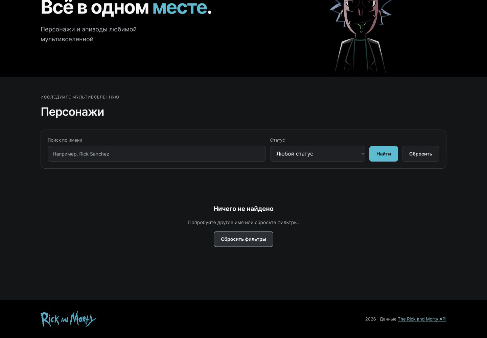

# Отчёт о QA-прогоне Rick and Morty React

## Результат

Дата: **16 ноября 2026 года**, Europe/Moscow. Браузерные доказательства собраны примерно **18:17–18:24 МСК**. Окружение и версия — в [README](README.md).

| Набор                                 | Результат                                                                                       |
| ------------------------------------- | ----------------------------------------------------------------------------------------------- |
| 15 браузерных кейсов                  | **13 Passed, 2 Failed**, без Blocked и Not run внутри этого набора                              |
| Чек-лист из 30 пунктов                | 23 browser Passed, 2 browser Failed, 3 Auto Passed, 2 Not run                                   |
| Существующие Vitest                   | **15/15 Passed**, 3 файла; команда завершилась с кодом 0                                        |
| TypeScript                            | `yarn type-check`, код завершения 0                                                             |
| Прямые live API-проверки из терминала | 3 проверки заблокированы: получен HTTP 403 с диагностическим ответом вместо ожидаемой схемы API |

Два дефекта воспроизведены по два раза и зарегистрированы со статусом Open / ожидает триажа. Предложенная severity — Minor, priority — P2, окончательное решение за владельцем проекта. Функциональные каталоги, поиск, фильтры, пагинация, история, модалка и адаптивность в выполненном объёме работают; клавиатурный поиск и переход из футера требуют обсуждения и исправления UX.

## Дефекты

| ID                         | Наблюдаемая проблема                                                                                | Кейс                         | Воспроизводимость         |
| -------------------------- | --------------------------------------------------------------------------------------------------- | ---------------------------- | ------------------------- |
| [BUG-001](bugs/BUG-001.md) | После отправки поиска по Enter фокус оказывается на BODY; следующий Tab повторно ведёт в поле имени | [TC-12](test-cases.md#tc-12) | 2/2, запросы Rick и Morty |
| [BUG-002](bugs/BUG-002.md) | Переход из футера эпизодов в персонажей сохраняет прокрутку и скрывает заголовок нового каталога    | [TC-13](test-cases.md#tc-13) | 2/2, scrollY=1109         |

Критерии ожидаемого поведения клавиатурного поиска и перехода к началу нового каталога сформулированы для учебного прогона. Это воспроизведённые UX-дефекты, а не заключение о соответствии всему стандарту доступности. Production-код не менялся для исправления этих проблем; ретест исправлений не выполнен.

## Выполненные проверки

1. Проверен корневой адрес: переход в персонажей, 20 карточек, данные первого видимого ряда и изображение Rick Sanchez.
2. Проверены эпизоды, активная навигация, поиск Rick, статус Dead и комбинация Rick/Alive.
3. Проверены смена страницы, граничные кнопки на первой/последней странице, сброс номера при новом поиске, reload и browser Back.
4. Проверены открытие деталей Rick, соответствие основных данных карточке, закрытие × и Escape, восстановление фокуса и прокрутки.
5. Проверен отсутствующий поисковый запрос `qa-nonexistent-20261116-9f7c`, пустое состояние без alert и возврат списка после сброса.
6. Проверены клавиатурный поиск, навигация из футера, клиентская 404 и возврат к персонажам.
7. Проверены viewport 320 × 1000, 768 × 1000 и 1440 × 1000: ширина документа равна viewport; сетка 1/2/4 колонки; модалка размещается в видимой области.

Полные шаги, фактические результаты и ссылки на изображения — в [15 тест-кейсах](test-cases.md). Машиночитаемые значения сохранены в [журнале наблюдений](evidence/browser-observations.json).

## Дополнительное UX-наблюдение

**OBS-001 — сообщение для страницы каталога вне диапазона. Статус: Needs clarification.**

При открытии `#/characters?page=999999` поля имени и статуса пусты, карточек и пагинации нет. Показано «Ничего не найдено» и «Попробуйте другое имя или сбросьте фильтры».

Возможное улучшение: отдельно объяснять, что указанной страницы не существует, либо возвращать пользователя на доступную страницу. Ожидание обработки такого URL не зафиксировано в исходных требованиях; наблюдение не включено в два подтверждённых дефекта и не увеличивает число Failed-кейсов.

## Автотесты и API

`yarn test` и `yarn type-check` действительно выполнены на проверенной локальной версии. [Вывод команд](evidence/automated-checks.txt) сохранён с кодами завершения.

Существующие 15 Vitest используют mocked fetch. Они подтверждают обработку 503, 404, отказа запроса, retry, abort и поздних ответов в соответствующих тестовых условиях. App tests используют MemoryRouter и jsdom; их синтетическое событие cancel для dialog не заменяет браузерную проверку Escape. Браузерный Escape в TC-10 выполнен отдельно.

Прямые запросы к `/api/character?page=1`, `/api/episode?page=1` и отсутствующему имени из терминальной сети получили 403 с диагностическим ответом Cloudflare. В этом сетевом пути контракт API независимо не подтверждён. Это ограничение инструмента/сети, а не доказанный дефект приложения. Во встроенном браузере реальные каталоги и фильтры отображались; HTTP-коды и тела этих браузерных запросов через Network отдельно не записывались.

## Ограничения

- Использован встроенный браузер; версия движка не предоставлена. Отдельный Google Chrome, Firefox и Safari не проверялись.
- 320/768/1440 — размеры CSS viewport одного браузера. Физические телефоны, touch-жесты и мобильные ОС не проверялись.
- Реальные Offline, throttling и серверная 503 в браузере не воспроизводились; их нельзя отмечать как ручные Passed. Нет управления сетевыми условиями в доступном браузерном интерфейсе.
- DevTools Network, Postman, Playwright-проект, SQL и нагрузочные/безопасностные проверки в этот прогон не входят.
- Сравнение полей модалки выполнено с выбранной карточкой; полный контракт backend для всех полей независимо не проверен.
- Скриншоты показывают только соответствующий момент. Фокус и координаты подтверждаются также журналом, а не исключительно изображением.
- Публичный набор персонажей может изменяться; наблюдаемые количества не являются фиксированными требованиями.

## Следующий прогон

Повторить сценарии самостоятельно в Chrome с зафиксированной версией и состояниями Network. После исправления BUG-001 и BUG-002 выполнить ретест, затем регрессию поиска, пагинации, browser Back и восстановления фокуса модалки. Не менять исторические фактические результаты этого прогона: сохранить новый отчёт с датой и commit.
